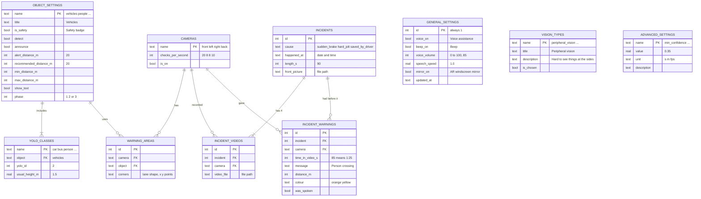

# Database design (Phase 2)

Status: built (2026-11-20), code in `server/app/storage/db.py`, tests in `server/tests/test_database.py`. The incident recorder (saving the 90 s videos) is not built yet; its tables are.

## In one paragraph

All settings and saved incidents are kept in one **SQLite** database: a single file on the
laptop, next to the server (`server/data/driving_assistant.db`). Only the server reads and
writes it. The apps (React, Next.js, later Flutter and React Native) never touch the file;
they ask the server through the API (`GET /api/settings`, `PATCH /api/settings`,
`GET /api/incidents`). So every app sees the same settings, and nothing is lost when the
server restarts. Video files are kept in folders; the database only stores where they are.

## The tables

There are 9 tables in two groups. Every table that the driver sees maps to one screen of
the presentation.

### Group 1: settings

| Table | Rows | Slide | What it holds |
| --- | --- | --- | --- |
| `general_settings` | 1 | 34 Settings (Voice and audio) | Voice on or off, beep on or off, voice volume, speech speed, mirror on or off |
| `vision_types` | 3 | 6–13 setup, 36–43 Vision type | Peripheral vision, night blindness, night vision: name, short description, and whether it is chosen |
| `object_settings` | 7 | 35 Detection and alerts | One row per object (vehicles, people, traffic lights, traffic signs, speed breakers, potholes, sign boards): detect, announce, alert distance, show text, plus the recommended distance and the allowed range for the minus and plus buttons |
| `yolo_classes` | 6 now | none (behind the scenes) | Links what YOLO detects (car, bus, truck, motorcycle, bicycle, person) to a row of `object_settings`, plus the usual height of that thing, used to guess its distance |
| `cameras` | 4 | 44 System status | Front, left, right, back: how many times per second the camera is checked (20, 8, 8, 10), and on or off |
| `warning_areas` | 8 | none (press D on the dashboard to see them) | For each camera and object: the area of the picture where something counts as a danger, e.g. our own lane on the front camera |
| `advanced_settings` | about 20 | none (for the team only) | Fine-tuning numbers, one per row with a description: minimum confidence, warning hold time, time a side car must be in view, gap between spoken warnings, and so on |

### Group 2: saved incidents

| Table | Rows | Slide | What it holds |
| --- | --- | --- | --- |
| `incidents` | one per saved incident, no limit | 45 Incident saved, 46 Saved incidents | Cause (sudden brake, hard jolt, saved by driver), date and time, length (90 s), front picture |
| `incident_videos` | 4 per incident | 47 Watch an incident | One video file per camera |
| `incident_warnings` | the warnings before it | 47 "Warnings before it" | Time in the video (1:25), what (Person crossing), which camera, distance, orange or yellow, and whether it was spoken |

## ERD

How to read the lines: `||--|{` means "one to one-or-more", `||--o{` means "one to zero-or-more".
For example, one incident has 4 videos, and one camera recorded many incident videos.

## Simple rules

1. **One file, on the laptop.** If the team uses one server for the demo, everyone shares the same settings.
2. **No users, no login.** The slides say nothing about the driver is stored.
3. **Videos stay as files** in `server/data/incidents/<id>/` (front.mp4, left.mp4, right.mp4, back.mp4, front.jpg). The database keeps the file paths.
4. **Delete an incident**, and its videos, warnings and folder go too.
5. **Reset to recommended** (slide 35) copies `recommended_distance_m` into `alert_distance_m` for every object.
6. **The minus and plus buttons** stop at `min_distance_m` and `max_distance_m` (slide 35 shows plus turned off at 20 m for vehicles and potholes).
7. **Apps never see tables.** `GET /api/settings` still returns one JSON object, so the apps don't change.
8. **Checks:** camera must be front, left, right or back; volume 0 to 100; distances above 0; cause must be one of the three.

## What changed after checking the slides

| Found on the slides | Before | Now |
| --- | --- | --- |
| Slide 34: Speech speed 1.0x, Beep checkbox, Voice volume 85% | missing | `speech_speed`, `beep_on`, `voice_volume` (0–100) |
| Slide 35: Safety badge, plus button turned off at 20 m, Reset to recommended | missing | `is_safety`, `min_distance_m`, `max_distance_m`, `recommended_distance_m` |
| Slides 36–43: three vision types with a description each | 3 yes/no columns | own small table `vision_types` |
| Slide 46: causes are Sudden brake, Saved by driver, Hard jolt | manual, danger_warning, hard_brake | `sudden_brake`, `saved_by_driver`, `hard_jolt` |
| Slide 47: warning list shows time in the video, distance and "spoken" | missing | `time_in_video_s`, `distance_m`, `was_spoken` |
| Too many technical columns in one table, hard to explain | about 35 columns | driver settings in `general_settings`, fine-tuning numbers in `advanced_settings` (one per row) |
| Technical names (conf, det_fps, position, polygon) | hard words | simple names (min_confidence, checks_per_second, camera, corners) |

The server code still uses its current names inside; only the database uses the simple names.
When we build it, the new settings (beep, speech speed, min and max distance) are added to
`schemas.py`, `docs/protocol.md` and `clients/shared` in the same change.

## Word list (for the presentation)

| Word | Meaning |
| --- | --- |
| Table | Like one sheet in Excel |
| Row | One line of a table, e.g. the "Vehicles" row |
| PK (primary key) | The column that names each row; no two rows share it |
| FK (foreign key) | A column that points to a row of another table, e.g. `incident_videos.camera` points to `cameras` |
| SQLite | A database that is just one file; no separate database program needed |
| API | The doors of the server the apps use to read and change data |
